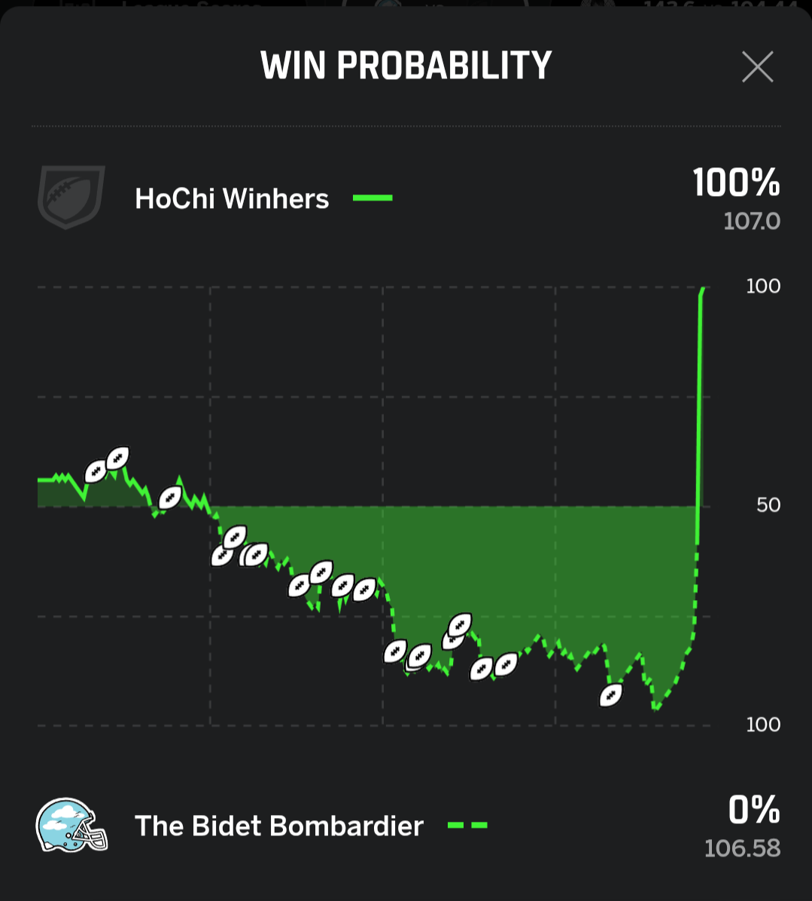
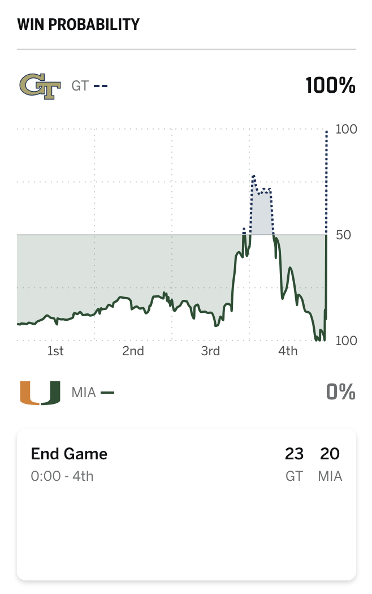
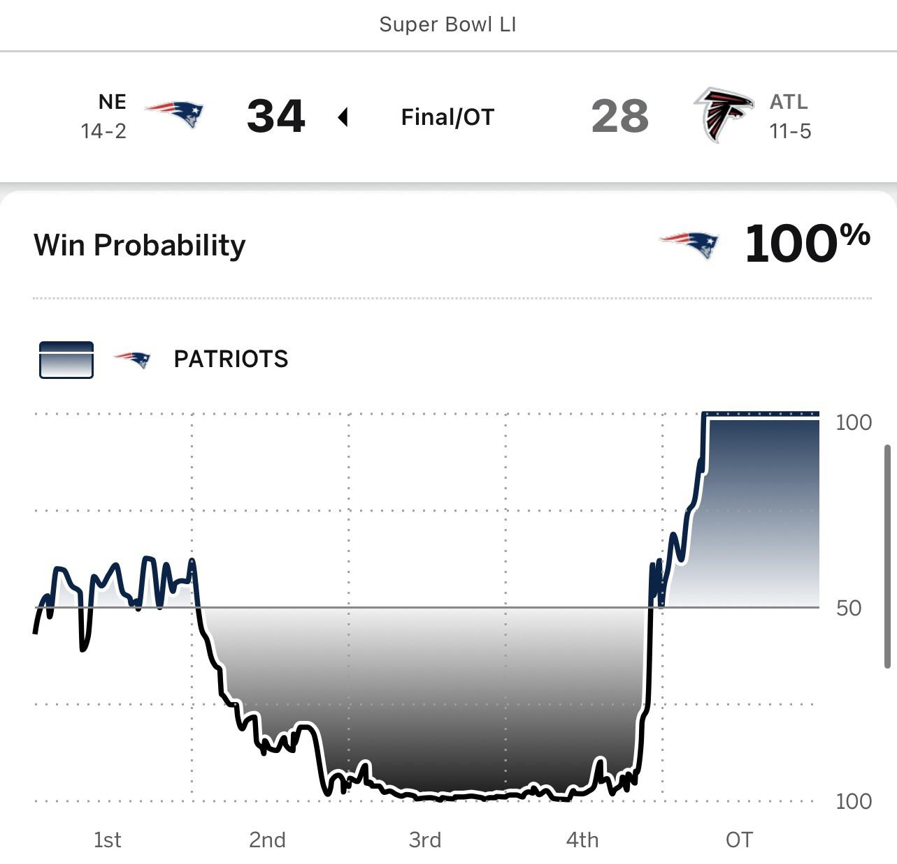

---
tags:
  - power-rankings
year: 2026
week: 8
title: WEEK 8 POWER RANKINGS
auto_date_created: 2026-11-03T14:31:26-05:00
auto_date_modified: 2026-11-03T16:56:34-05:00
---

## 1  Peck - Mike Vick Walks My Dog  (5-3)

Lost to I'm so JamesCooked (joe) 117.58-118.80


| Stat | Value |
| --- | --- |
| Win percentage | 62.5% |
| Win percentage against league | 75.0% |
| Highest scorer | QB Joe Burrow (39.48) |
| Recent results | W, W, W, W, L |
| Average margin | 13.72 |
| Projected points | 137.22 |
| Actual points | 117.58 |
| Average score | 130.00 |


<!-- BEGIN TEAM BLURB team_id=12 -->
Peck dropped his game against Joe this week but the one point loss wasn't enough to drop him down the rankings. He's still averaging 10 more points than anyone else in the league so he's earned his spot here for the time being. However, he goes against Christian who is the second highest scorer in the league this week
<!-- END TEAM BLURB team_id=12 -->

---

## 2  Steven - 5K Runner  (6-2)

Lost to I'm Love'n Ja'Matt Chase 5ks (Zach) 88.44-115.98


| Stat | Value |
| --- | --- |
| Win percentage | 75.0% |
| Win percentage against league | 51.1% |
| Highest scorer | WR Malik Washington (15.00) |
| Recent results | W, W, W, L, L |
| Average margin | 13.98 |
| Projected points | 105.29 |
| Actual points | 88.44 |
| Average score | 116.87 |


<!-- BEGIN TEAM BLURB team_id=9 -->
After being unstoppable to start the season Steve has started to fall apart a bit. He was average 120 points through the first six weeks but has now averaged 100 points since. It's a steep drop off but at this point in the season it's hard to imagine that the drop off would be enough to keep him out of the playoffs.
<!-- END TEAM BLURB team_id=9 -->

---

## 3  David - HoChi Winhers ▲1 (5-3)

Beat The Bidet Bombardier (Brian) 107.00-106.58


| Stat | Value |
| --- | --- |
| Win percentage | 62.5% |
| Win percentage against league | 54.5% |
| Highest scorer | RB Jaylen Warren (21.30) |
| Recent results | L, W, L, W, W |
| Average margin | 8.13 |
| Projected points | 122.61 |
| Actual points | 107.00 |
| Average score | 118.92 |


<!-- BEGIN TEAM BLURB team_id=1 -->
Lamar Jackson, my top draft pick, returned after missing the last 3 weeks. He lasted one play before snapping his thumb and needing surgery. 

I was doomed to lose immediately after losing my best player. There was no hope. 

But what was that? A hum in the distance. A faint murmur of babbling water. A flushing of the dread. A rejuvenation of my tank. 

Behold, a porcelain throne comes to my aid. 

I rise again like a fill valve's float to victory.
<!-- END TEAM BLURB team_id=1 -->

---

## 4  Nathan - Less Intelligent Underwood ▼1 (4-4)

Lost to GT sux (Christian) 104.44-143.60


| Stat | Value |
| --- | --- |
| Win percentage | 50.0% |
| Win percentage against league | 53.4% |
| Highest scorer | QB Patrick Mahomes (25.44) |
| Recent results | W, L, L, W, L |
| Average margin | 9.55 |
| Projected points | 119.63 |
| Actual points | 104.44 |
| Average score | 119.12 |


<!-- BEGIN TEAM BLURB team_id=6 -->
For the first time in Nathan's FF history he lost to his little brother. That historic defeat was enough to drop him down the rankings a little. But, he's still the second highest scorer in the league despite a down week and has a 77% chance to make the playoffs. 
<!-- END TEAM BLURB team_id=6 -->

---

## 5  joe - I'm so JamesCooked  (4-4)

Beat Mike Vick Walks my Dog (Peck) 118.80-117.58


| Stat | Value |
| --- | --- |
| Win percentage | 50.0% |
| Win percentage against league | 55.7% |
| Highest scorer | RB Bhayshul Tuten (29.90) |
| Recent results | W, L, W, L, W |
| Average margin | -4.91 |
| Projected points | 119.84 |
| Actual points | 118.80 |
| Average score | 116.74 |


<!-- BEGIN TEAM BLURB team_id=15 -->
Joe continues to stay afloat by barely beating Peck and settling in the middle of the pack. He started the season a bit unlucky but he's overcome it to be at a comfortable 75% chance of making the playoffs.
<!-- END TEAM BLURB team_id=15 -->

---

## 6  Zach - I'm Love'n Ja'Matt Chase 5ks  (4-4)

Beat 5K Runner (Steven) 115.98-88.44


| Stat | Value |
| --- | --- |
| Win percentage | 50.0% |
| Win percentage against league | 53.4% |
| Highest scorer | RB Josh Jacobs (23.20) |
| Recent results | W, L, W, W, W |
| Average margin | 4.40 |
| Projected points | 126.62 |
| Actual points | 115.98 |
| Average score | 113.83 |


<!-- BEGIN TEAM BLURB team_id=8 -->
Zach finally got it together and has rattled off 3 straight wins after a terrible start to the season. Kudos to him! Now, did his waiver wire gambit work? No not really. His best pickup this year has been his kicker that he didn't get on waivers and only scored 1 point this week. But hey, he's gotten to 4 wins and plays the toilet bowl this week so maybe he can keep it going.  
<!-- END TEAM BLURB team_id=8 -->

---

## 7  Christian - GT Sux ▲3 (5-3)

Beat Less Intelligent Underwood (Nathan) 143.60-104.44


| Stat | Value |
| --- | --- |
| Win percentage | 62.5% |
| Win percentage against league | 40.9% |
| Highest scorer | WR Ja'Marr Chase (31.10) |
| Recent results | L, L, L, W, W |
| Average margin | 8.93 |
| Projected points | 120.85 |
| Actual points | 143.60 |
| Average score | 107.93 |


<!-- BEGIN TEAM BLURB team_id=5 -->
Whew, hell hath no fury like a younger brother who has been repeatedly beat up. Christian crushed Nathan this week for his first ever win over his older brother. That's great! Less great is that no other team in our history has had 5 wins through week 8 with a worse record agains the league. Here are the 10 worst teams with 5 wins through 8 weeks, he's been extremely lucky so far this year and he'll just hope that luck holds out a little longer.

| Year | Team Name                  | Owner               | Power Rank | Win % Against League |
| ---- | -------------------------- | ------------------- | ---------- | -------------------- |
| 2026 | GT sux                     | Christian Underwood | 7          | 41%                  |
| 2019 | Return of the Joe-di       | joe banks           | 7          | 43%                  |
| 2023 | HoChi Winhers              | David Anderson      | 7          | 44%                  |
| 2020 | Team covid (We da illest)  | joe banks           | 5          | 48%                  |
| 2022 | The Name's Pete ...Re-Pete | joe banks           | 5          | 48%                  |
| 2021 | NoPunt Intended Quaranteam | Steven Klein        | 5          | 49%                  |
| 2021 | The Founding Father        | David Anderson      | 3          | 50%                  |
| 2019 | Not Cope                   | Hunter Hughes       | 3          | 52%                  |
| 2023 | Favreorite Team            | Zach Scott          | 6          | 52%                  |
| 2024 | Favreorite Team            | Zach Scott          | 3          | 53%                  |

<!-- END TEAM BLURB team_id=5 -->

---

## 8  Alan - Deport SEC Fans ▲1 (4-4)

Beat BUZZ SAW COMING FOR YOU (Matthew) 111.76-86.26


| Stat | Value |
| --- | --- |
| Win percentage | 50.0% |
| Win percentage against league | 48.9% |
| Highest scorer | RB Tony Pollard (28.70) |
| Recent results | W, W, W, L, W |
| Average margin | -7.61 |
| Projected points | 116.03 |
| Actual points | 111.76 |
| Average score | 110.20 |


<!-- BEGIN TEAM BLURB team_id=3 -->
Alan beat Matt and got to slightly move up but anything with a pulse would beat Matt this week so his movement was more due to people falling on their face than his performance. Alan is pretty unremarkable this season and right now he's projected to be the last playoff team to escape the consolation bracket.
<!-- END TEAM BLURB team_id=3 -->

---

## HERE ARE THE LIKELY RUNNERS

## 9  Robb - Lombardi's Lad's ▲2 (4-4)

Beat Knights of the Night (Hunter) 140.36-92.98


| Stat | Value |
| --- | --- |
| Win percentage | 50.0% |
| Win percentage against league | 46.6% |
| Highest scorer | QB Josh Allen (26.56) |
| Recent results | L, W, L, L, W |
| Average margin | -6.64 |
| Projected points | 122.79 |
| Actual points | 140.36 |
| Average score | 108.00 |


<!-- BEGIN TEAM BLURB team_id=13 -->
Robb beat Hunter this week and that moved him up but he's still headed for the runners bracket. Statically Robb has been lucky to even be 9th so far since he's out performing his record against the league but that luck hasn't been enough to climb our of the pit. He gets Joe this week which gives him a real chance to climb out of the pit into the middle and the playoff race. 
<!-- END TEAM BLURB team_id=13 -->

---

## 10  Hunter - Knights of the Night ▼3 (3-5)

Lost to Lombardi's  Lad's (Robb) 92.98-140.36


| Stat | Value |
| --- | --- |
| Win percentage | 37.5% |
| Win percentage against league | 47.7% |
| Highest scorer | RB D'Andre Swift (27.90) |
| Recent results | L, W, W, L, L |
| Average margin | -8.77 |
| Projected points | 114.69 |
| Actual points | 92.98 |
| Average score | 110.53 |


<!-- BEGIN TEAM BLURB team_id=14 -->
What a collapse. At 3-5 ESPN gives Hunter a 50% chance to be in the consolation bracket, the third worst in the league. However, Hunter has been the second most volatile scorer in the league this with a scoring standard deviation of 43.4 points. If he can get a few weeks of that volatility working in his favor he still has a chance to make it.
<!-- END TEAM BLURB team_id=14 -->

---

## 11  Brian - The Bidet Bombardier ▼3 (2-6)

Lost to HoChi Winhers (David) 106.58-107.00


| Stat | Value |
| --- | --- |
| Win percentage | 25.0% |
| Win percentage against league | 53.4% |
| Highest scorer | WR Tee Higgins (37.50) |
| Recent results | L, L, L, W, L |
| Average margin | -4.29 |
| Projected points | 109.73 |
| Actual points | 106.58 |
| Average score | 117.83 |


<!-- BEGIN TEAM BLURB team_id=4 -->
No one has been more unlucky than Brian this year. It's not close. I've literally done the math. Based on Brian's weekly scoring he should be expected to have won 4.27 games so far. He's won 2. And two weeks in a row he's done it in spectacular fashion snatching defeat from the jaws of victory. Based on my math, Brian's season is the 7th most unlucky season out of the 96 team seasons since 2019 where my stats start. It's incredibly bad. Below is the luck for every team so far this year, Brian's gap with his neighbor Peck in luck is bigger than any other teams in the entire league. 

| owner               | wins | losses | expected wins | luck  |
| ------------------- | ---- | ------ | ------------- | ----- |
| Brian Anderson      | 2    | 6      | 4.27          | -2.27 |
| Peck Mallory        | 5    | 3      | 6.0           | -1.0  |
| Hunter Hughes       | 3    | 5      | 3.82          | -0.82 |
| joe banks           | 4    | 4      | 4.45          | -0.45 |
| Nathan Underwood    | 4    | 4      | 4.27          | -0.27 |
| Zach Scott          | 4    | 4      | 4.27          | -0.27 |
| Alan Anderson       | 4    | 4      | 3.91          | 0.09  |
| Robb McBride        | 4    | 4      | 3.73          | 0.27  |
| Matthew Anderson    | 2    | 6      | 1.55          | 0.45  |
| David Anderson      | 5    | 3      | 4.36          | 0.64  |
| Christian Underwood | 5    | 3      | 3.27          | 1.73  |
| Steven Klein        | 6    | 2      | 4.09          | 1.91  |

Anyways, here is the one of a kind win probability chart of Brian's this week along with some similar charts I found.

**Brian vs David**

{width=400}

**Tech vs Miami 2023**

{width=400}

**That Game**

{width=400}

<!-- END TEAM BLURB team_id=4 -->

---

## 12  Matthew - BUZZ SAW COMING FOR YOU  (2-6)

Lost to Deport SEC Fans (Alan) 86.26-111.76


| Stat | Value |
| --- | --- |
| Win percentage | 25.0% |
| Win percentage against league | 19.3% |
| Highest scorer | QB Drake Maye (22.46) |
| Recent results | L, L, L, L, L |
| Average margin | -26.49 |
| Projected points | 109.49 |
| Actual points | 86.26 |
| Average score | 92.16 |


<!-- BEGIN TEAM BLURB team_id=2 -->
I mean... what can I say at this point? I'm at a loss of words. Matt has an 11% chance to make the playoffs according to ESPN and at this point he'll be extremely lucky to not be running. At 92 average points Matt has the lowest avg through week of all time. At 19% he has the lowest win percentage against the league of all time. He also has the lowest standard deviation of his score this season. Meaning he's extremely consistent at being so bad. The only slight positive for Matt, and it is very slight, is that he has the second worst score vs ESPN projected score (-22.6). So theoretically he should be much better than this. But if you gave him that extra 22 points per a week, he'd still have the 9th lowest average score through week 8 in the history of the league.... wow he is so bad.
<!-- END TEAM BLURB team_id=2 -->

---

